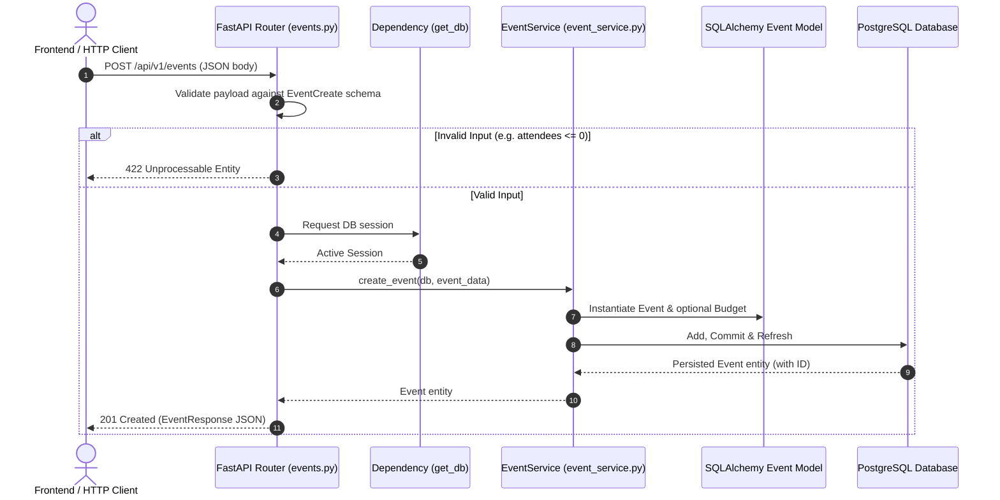
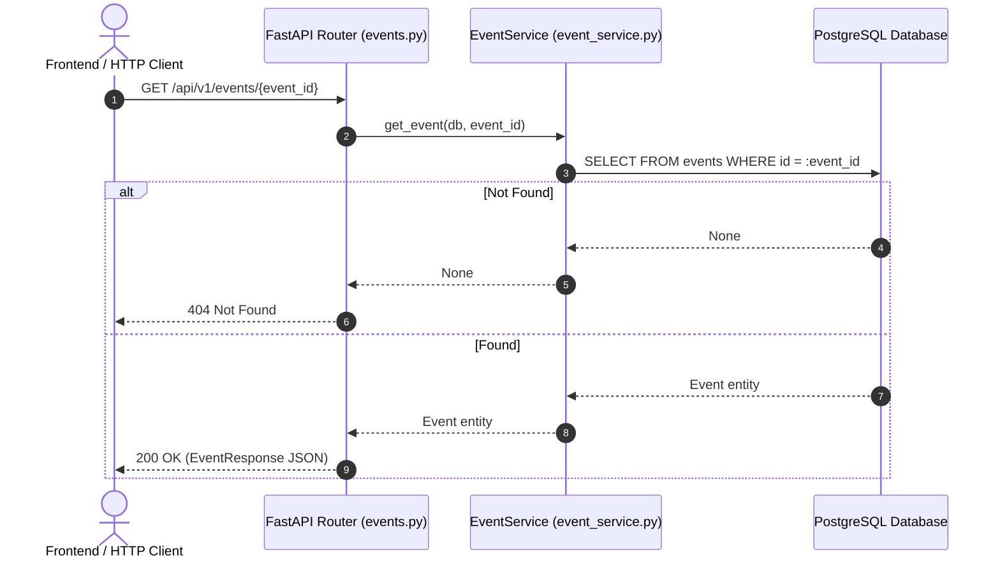

# Backend Architecture & Request Flow (Phase 1)

## Architecture Overview
The system follows a **Modular Monolith** pattern built with **FastAPI**, **SQLAlchemy 2.x**, and **PostgreSQL**.

The design enforces strict layer decoupling:
1. **API Layer (`backend/app/api/`)**: HTTP endpoints, input serialization, status codes, and error formatting.
2. **Service Layer (`backend/app/services/`)**: Business transaction boundaries, persistence coordination, and validation orchestration.
3. **Data Model Layer (`backend/app/models/`)**: Declarative SQLAlchemy models representing relational database tables and foreign key constraints.
4. **Schemas Layer (`backend/app/schemas/`)**: Pydantic models for validation and serialization (DTOs).

---

## Phase 1 Request Flow



---

## Retrieval Flow



---

## Future Planning Request Flow (Target)

When future domain modules (Food, Waste, Water, etc.) are implemented, they will seamlessly plug into this flow:

```
API Route (planning.py)
      ↓
Planning Service (plan_service.py)
      ↓
Planning Orchestrator (planner.py)
      ↓
Domain Planning Modules (Food, Waste, Water, Energy, Transport, Venue, Carbon)
      ↓
Cost / Constraint / Assumption Engines
      ↓
Sustainability Engine
      ↓
Plan Generation & Database Persistence
```
